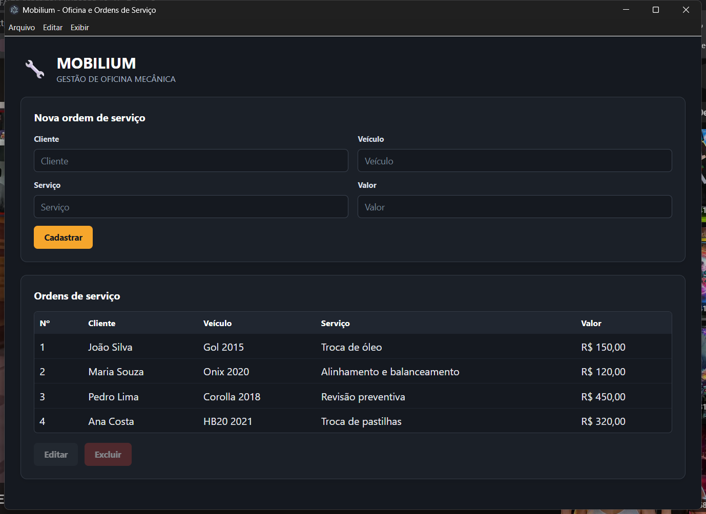
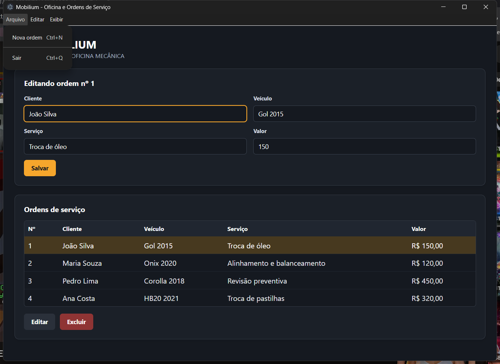

# Mobilium — Gestão de Oficina Mecânica (Electron)

Aplicação desktop para gerenciar **ordens de serviço** de uma oficina mecânica.
É a reconstrução em Electron do sistema desenvolvido em JavaFX, mantendo a entidade e os campos das ordens, agora com duas telas, separação entre processos, comunicação por IPC, recursos nativos do sistema operacional e persistência em arquivo JSON.

Disciplina **Programação Desktop**.

## Funcionalidades

- Cadastrar uma ordem de serviço (cliente, veículo, serviço e valor)
- Listar todas as ordens, com o valor formatado em R$
- Editar uma ordem existente (o mesmo formulário serve para cadastrar e editar)
- Excluir uma ordem, com confirmação em **diálogo nativo** do sistema
- Validação dos campos obrigatórios e máscara no campo de valor (até 2 casas decimais)
- Menu nativo com atalhos de teclado
- Dados salvos automaticamente em arquivo JSON a cada alteração

A navegação superior alterna entre **Visão geral** e **Ordens**. O botão **Nova ordem** abre o formulário de cadastro na tela Ordens.

- **Visão geral:** tela inicial com as contagens de ordens e clientes, o valor total em ordens, os cinco cadastros mais recentes pelo número e até cinco serviços mais frequentes. Sem ordens, apresenta o convite para cadastrar o primeiro serviço. Os valores cadastrados não indicam pagamentos recebidos.
- **Ordens:** cadastro, edição e exclusão, com busca por número, cliente, veículo ou serviço. Selecione uma linha para habilitar Editar e Excluir. **Cancelar edição** limpa o formulário sem salvar alterações.

Após cadastrar, editar ou excluir uma ordem, as listas, os valores e as contagens das duas telas são atualizados a partir das ordens salvas. As buscas ignoram diferenças de maiúsculas e acentos.

## Tecnologias

- [Electron](https://www.electronjs.org/)
- HTML, CSS e JavaScript (sem frameworks)
- Node.js (`fs/promises`, `path`)

## Como executar

Pré-requisitos: [Node.js](https://nodejs.org/) (versão LTS) e Git.

```bash
git clone https://github.com/felipedvd2025/oficina-electron.git
cd oficina-electron
npm install
npm start
```

Para executar os testes das consultas e dos resumos:

```bash
node --test test/dados-oficina.test.js
```

## Atalhos de teclado

| Atalho | Ação |
|---|---|
| `Ctrl + N` | Nova ordem (limpa o formulário e foca no campo Cliente) |
| `Ctrl + Q` | Sair da aplicação |
| `Enter` | Cadastrar / salvar o formulário |

## Estrutura do projeto

```text
oficina-electron/
├── package.json      # dados do projeto, script de execução e dependências
├── main.js           # processo principal: janela, menu e handlers de IPC
├── preload.js        # expõe o window.api para a tela com contextBridge
├── repositorio.js    # leitura e gravação do arquivo JSON
├── README.md
├── src/
│   ├── index.html        # estrutura das duas telas
│   ├── style.css         # estilo visual
│   ├── dados-oficina.js  # busca e resumo das ordens
│   └── renderer.js       # navegação e interação (usa apenas o window.api)
└── test/
    └── dados-oficina.test.js # testes das consultas e dos resumos
```

## Arquitetura

O Electron separa a aplicação em dois tipos de processo:

- **Processo principal (`main.js`)** — tem acesso ao sistema operacional. Cria a janela, monta o menu nativo, abre o diálogo de confirmação e responde aos pedidos da tela. Os handlers apenas recebem e **delegam** ao `repositorio.js`.
- **Processo de renderização (`src/`)** — a tela, que funciona como uma página web. Por segurança, roda com `contextIsolation: true` e `nodeIntegration: false`: não usa `require`, `fs` nem nada do Node.
- **Preload (`preload.js`)** — a ponte entre os dois. Usa `contextBridge` para expor na tela somente as funções necessárias, no objeto `window.api`.

```text
renderer.js ──window.api──► preload.js ──IPC──► main.js ──► repositorio.js ──► ordens.json
```

### Canais IPC

| Canal | Sentido | Função no `window.api` | O que faz |
|---|---|---|---|
| `ordens:listar` | tela → principal | `listar()` | Devolve todas as ordens |
| `ordens:cadastrar` | tela → principal | `cadastrar(dados)` | Cria uma ordem com número automático |
| `ordens:editar` | tela → principal | `editar(ordem)` | Atualiza uma ordem pelo número |
| `ordens:excluir` | tela → principal | `excluir(numero)` | Pede confirmação no diálogo nativo e exclui |
| `menu:nova-ordem` | principal → tela | `aoNovaOrdem(callback)` | Avisa a tela que o Ctrl+N foi acionado |

A comunicação tela → principal usa `ipcRenderer.invoke` / `ipcMain.handle`. O aviso do menu (principal → tela) usa `webContents.send` / `ipcRenderer.on`.


## Capturas de tela

**Visão geral**


**Ordens de serviço**



**Modo edição**


**Confirmação de exclusão (diálogo nativo)**


**Menu nativo com atalhos**



## Checklist de testes

O checklist abaixo registra a verificação pela interface do aplicativo com dados demonstrativos isolados. A integração das duas telas foi validada no Electron com dados temporários e confirmação de exclusão controlada no teste. Os quatro testes de consultas e resumos passaram, cobrindo estado vazio, contagem de clientes, totais, ordenação e busca.

- [x] Primeira execução sem o arquivo JSON: abre na Visão geral com contagens zeradas e convite para cadastrar a primeira ordem
- [x] Cadastro pelo botão e pelo Enter, com número automático e valor em R$
- [x] Validação dos campos obrigatórios (cliente, veículo e serviço)
- [x] Máscara do campo valor (só números, até 2 casas decimais)
- [x] Dados mantidos ao fechar e abrir o app
- [x] Editar e Excluir desativados sem linha selecionada
- [x] Edição de uma ordem, gravada na hora
- [x] Exclusão cancelada no diálogo nativo não altera nada
- [x] Exclusão confirmada no diálogo nativo remove a ordem e grava na hora
- [x] `Ctrl + N` limpa o formulário e foca no campo Cliente
- [x] `Ctrl + Q` fecha a aplicação

## Equipe
| Felipe da Costa Mota
| Vitor Sâmile Silva Santos 
| Luís Felype Monteiro da Silva Sousa
| Luan Lucas Oliveira Sousa

