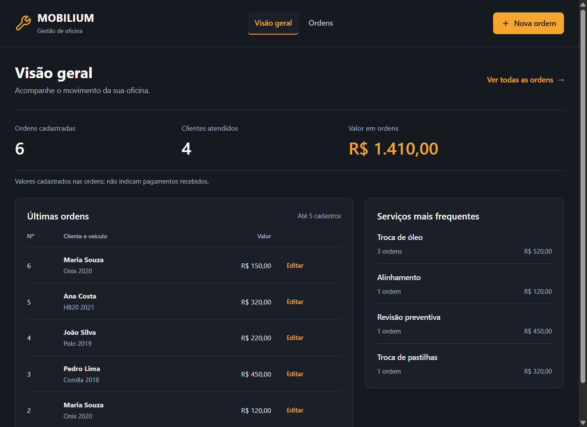
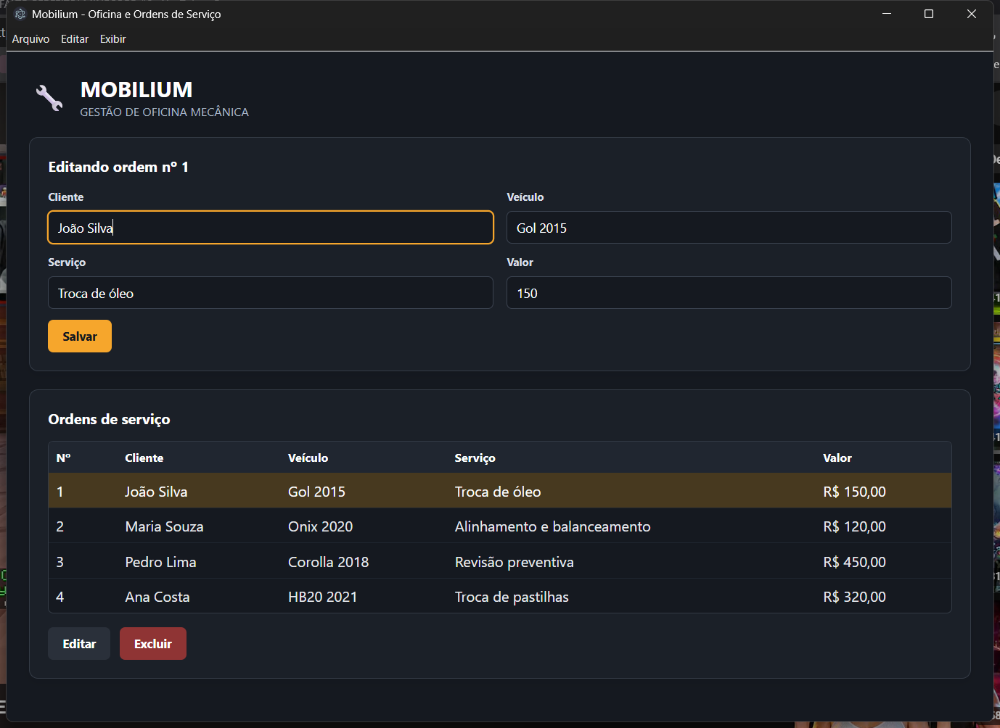
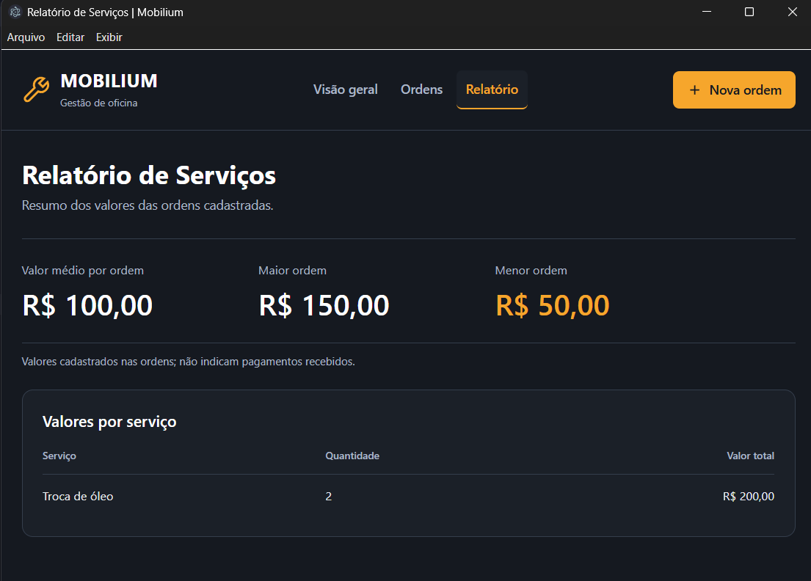
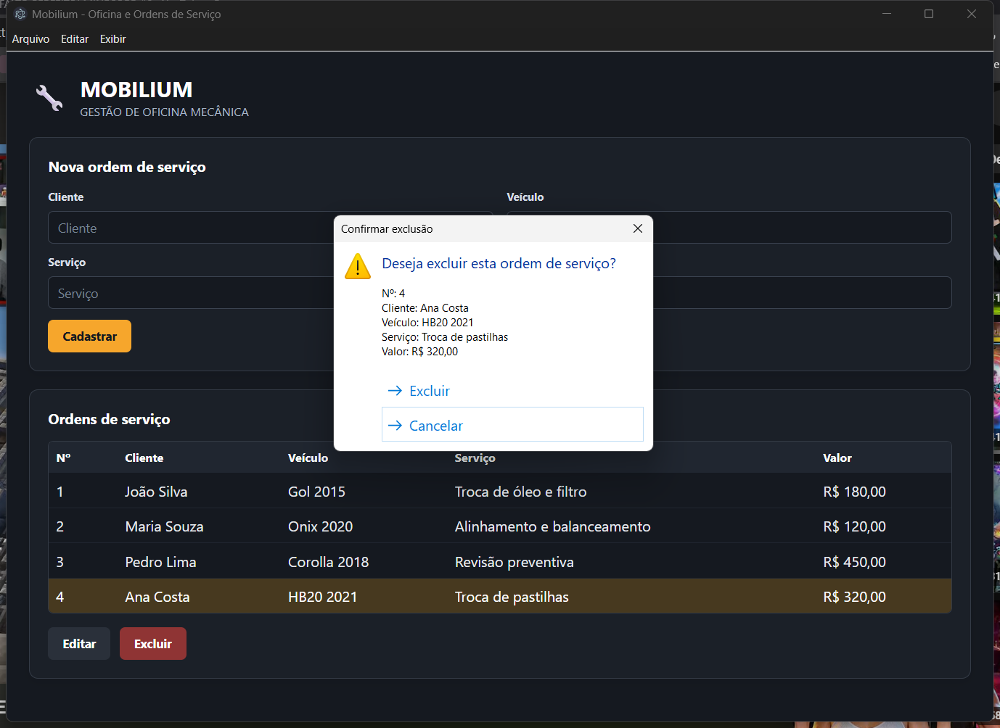

# Mobilium — Gestão de Oficina Mecânica (Electron)

Aplicação desktop para gerenciar **ordens de serviço** de uma oficina mecânica.

É a reconstrução em Electron do sistema desenvolvido em JavaFX, mantendo a entidade e os campos das ordens, agora com **três telas**, separação entre processos, comunicação por IPC, recursos nativos do sistema operacional e persistência em arquivo JSON.

Disciplina **Programação Desktop**.

## Funcionalidades

- Cadastrar uma ordem de serviço (cliente, veículo, serviço e valor)
- Listar todas as ordens, com o valor formatado em R$
- Editar uma ordem existente utilizando o mesmo formulário do cadastro
- Excluir uma ordem, com confirmação em diálogo nativo do sistema
- Validar os campos obrigatórios e limitar o valor a duas casas decimais
- Buscar ordens por número, cliente, veículo ou serviço
- Navegar entre Visão Geral, Ordens e Relatório
- Consultar indicadores e valores agrupados por serviço
- Utilizar menu nativo com atalhos de teclado
- Salvar os dados automaticamente em arquivo JSON

## Telas do aplicativo

A navegação superior permite alternar entre **Visão geral**, **Ordens** e **Relatório**.

### Visão Geral

Tela inicial com informações sobre as ordens cadastradas:

- Quantidade de ordens
- Quantidade de clientes atendidos
- Valor total das ordens
- Cinco ordens mais recentes
- Até cinco serviços mais frequentes

Quando não existem ordens, a tela apresenta uma mensagem convidando o usuário a realizar o primeiro cadastro.

### Ordens de Serviço

Permite realizar as operações do CRUD:

- **Cadastrar:** registrar uma nova ordem de serviço
- **Listar:** visualizar e pesquisar as ordens cadastradas
- **Editar:** alterar os dados de uma ordem existente
- **Excluir:** remover uma ordem após confirmação

O mesmo formulário é utilizado para cadastrar e editar.

A busca permite localizar registros por número, cliente, veículo ou serviço, ignorando diferenças de letras maiúsculas e acentos.

### Relatório de Serviços

Terceira tela adicionada ao aplicativo para apresentar informações sobre os serviços cadastrados.

O relatório exibe:

- **Valor médio por ordem:** média dos valores cadastrados
- **Maior ordem:** maior valor encontrado
- **Menor ordem:** menor valor encontrado
- **Valores por serviço:** quantidade de ordens e valor total de cada serviço

Os cálculos são realizados em JavaScript, utilizando os dados já carregados pelo sistema.

Após cadastrar, editar ou excluir uma ordem, os indicadores são atualizados automaticamente.

O relatório não precisa de outro arquivo JSON nem de novos canais IPC.

**Observação:** os valores cadastrados não representam necessariamente pagamentos recebidos.

## Tecnologias

- [Electron](https://www.electronjs.org/)
- HTML, CSS e JavaScript, sem frameworks
- Node.js (`fs/promises`, `path`)
- JSON para persistência de dados

## Como executar

Pré-requisitos: [Node.js](https://nodejs.org/) (versão LTS) e Git.

Clone o repositório:

```bash
git clone https://github.com/felipedvd2025/oficina-electron.git
```

Entre na pasta:

```bash
cd oficina-electron
```

Instale as dependências:

```bash
npm install
```

Execute o aplicativo:

```bash
npm start
```

## Atalhos de teclado

| Atalho | Ação |
|---|---|
| `Ctrl + N` | Nova ordem (limpa o formulário e foca no campo Cliente) |
| `Ctrl + Q` | Sair da aplicação |
| `Enter` | Cadastrar ou salvar o formulário |

## Estrutura do projeto

```text
oficina-electron/
├── package.json
├── package-lock.json
├── main.js
├── preload.js
├── repositorio.js
├── README.md
├── docs/
│   ├── visao-geral.png
│   ├── tela-principal.png
│   ├── modo-edicao.png
│   ├── dialogo-exclusao.png
│   ├── menu.png
│   └── relatorio-servicos.png
└── src/
    ├── index.html
    ├── style.css
    ├── dados-oficina.js
    └── renderer.js
```

### Responsabilidade dos arquivos

| Arquivo | Responsabilidade |
|---|---|
| `package.json` | Configurações, dependências e execução |
| `main.js` | Janela, menu nativo e handlers IPC |
| `preload.js` | Comunicação entre a interface e o processo principal |
| `repositorio.js` | Leitura e gravação das ordens no JSON |
| `src/index.html` | Estrutura das três telas |
| `src/style.css` | Aparência do aplicativo |
| `src/dados-oficina.js` | Busca e resumo das ordens |
| `src/renderer.js` | CRUD, navegação, eventos e relatório |
| `docs/` | Capturas de tela para documentação |

## Arquitetura

O Electron separa a aplicação em dois tipos de processo.

### Processo principal

O `main.js` tem acesso aos recursos do sistema operacional.

Suas responsabilidades incluem:

- Criar a janela do aplicativo
- Configurar o menu nativo
- Receber solicitações por IPC
- Exibir o diálogo de confirmação de exclusão
- Delegar operações ao `repositorio.js`

### Processo de renderização

Os arquivos da pasta `src/` controlam a interface.

O `renderer.js` responde às ações do usuário, como cadastrar, editar, excluir, navegar e consultar o relatório.

Por segurança, a aplicação utiliza:

- `contextIsolation: true`
- `nodeIntegration: false`

Dessa forma, a interface não acessa diretamente os recursos do Node.js.

### Preload

O `preload.js` utiliza `contextBridge` para disponibilizar somente as funções necessárias por meio de `window.api`.

### Fluxo de comunicação

```text
renderer.js
    |
    v
preload.js
    |
    v
main.js
    |
    v
repositorio.js
    |
    v
ordens.json
```

## Canais IPC

| Canal | Função no `window.api` | Descrição |
|---|---|---|
| `ordens:listar` | `listar()` | Carrega todas as ordens |
| `ordens:cadastrar` | `cadastrar(dados)` | Cadastra uma ordem |
| `ordens:editar` | `editar(ordem)` | Atualiza uma ordem existente |
| `ordens:excluir` | `excluir(numero)` | Confirma e exclui uma ordem |
| `menu:nova-ordem` | `aoNovaOrdem(callback)` | Avisa a tela quando Ctrl+N é acionado |

As solicitações da interface utilizam `ipcRenderer.invoke` e `ipcMain.handle`.

O aviso do menu utiliza `webContents.send` e `ipcRenderer.on`.

## Persistência em JSON

Os dados são armazenados em um arquivo `ordens.json`, na pasta de dados da aplicação definida pelo Electron.

O repositório utiliza:

- `fs.readFile()` para leitura
- `fs.writeFile()` para gravação
- `JSON.parse()` para transformar JSON em objetos JavaScript
- `JSON.stringify()` para converter objetos em texto JSON

Na primeira execução, se o arquivo ainda não existir, a aplicação inicia com uma lista vazia.

Após cadastrar, editar ou excluir, as alterações são salvas no arquivo.

## Funcionamento do Relatório

A tela Relatório utiliza as informações das ordens cadastradas.

A função `renderizarRelatorio()`, localizada no `src/renderer.js`, realiza os cálculos e atualiza a interface.

### Cálculos

- `map()` obtém os valores das ordens
- `reduce()` soma os valores
- `Math.max()` identifica o maior valor
- `Math.min()` identifica o menor valor
- `Map` e `for...of` agrupam os serviços

Para calcular a média, o total dos valores é dividido pela quantidade de ordens.

O agrupamento considera o nome do serviço após remover espaços do início e do fim. Portanto, nomes com diferenças de letras maiúsculas ou acentos podem aparecer separadamente no relatório.

### Atualização automática

A função `renderizar()` atualiza:

1. A tabela de ordens
2. A Visão Geral
3. O Relatório de Serviços

Assim, as três telas permanecem sincronizadas com os registros carregados.

## Capturas de tela

### Visão Geral



### Ordens de Serviço


### Modo de Edição



### Relatório de Serviços



### Confirmação de Exclusão



### Menu Nativo


## Checklist de funcionamento

Verificações realizadas durante o desenvolvimento:

- [x] Primeira execução sem arquivo JSON
- [x] Cadastro de ordens pelo formulário
- [x] Número da ordem gerado automaticamente
- [x] Validação dos campos obrigatórios
- [x] Máscara de valor com até duas casas decimais
- [x] Valores exibidos em reais
- [x] Persistência dos registros em JSON
- [x] Listagem das ordens cadastradas
- [x] Busca por número, cliente, veículo ou serviço
- [x] Edição de ordens existentes
- [x] Exclusão com confirmação em diálogo nativo
- [x] Cancelamento de exclusão sem alterar os dados
- [x] Menu nativo com atalhos
- [x] Navegação entre as três telas
- [x] Cálculo da média, maior e menor valor no relatório
- [x] Agrupamento de serviços por quantidade e valor
- [x] Atualização do relatório após novo cadastro

O arquivo de testes automatizados utilizado anteriormente foi removido do repositório. O checklist acima registra as verificações realizadas pela interface.

## Atualizações recentes

### 25/11/2026

- Adicionada a terceira tela: Relatório de Serviços
- Implementados indicadores de média, maior e menor valor
- Adicionado agrupamento de ordens por serviço
- Atualizada a navegação para três telas
- Removido o arquivo antigo de testes automatizados
- Atualizada a documentação com a captura do relatório

### 24/11/2026

- Adicionada a tela de Visão Geral
- Implementada a navegação entre telas
- Adicionados recursos de cadastro, edição e exclusão
- Implementado o menu nativo com atalhos
- Adicionado o diálogo de confirmação de exclusão
- Melhorados os estados de hover, foco e botões desativados
- Adicionadas capturas de tela ao README

## Equipe

- Felipe da Costa Mota
- Vitor Sâmile Silva Santos
- Luís Felype Monteiro da Silva Sousa
- Luan Lucas Oliveira Sousa

**Instituto Federal do Maranhão — Campus Grajaú**

**Disciplina:** Programação Desktop
